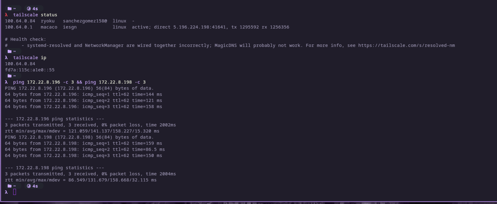
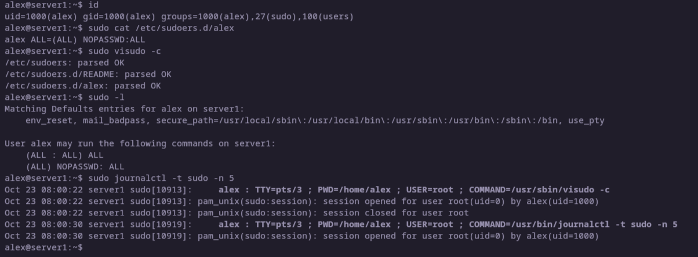
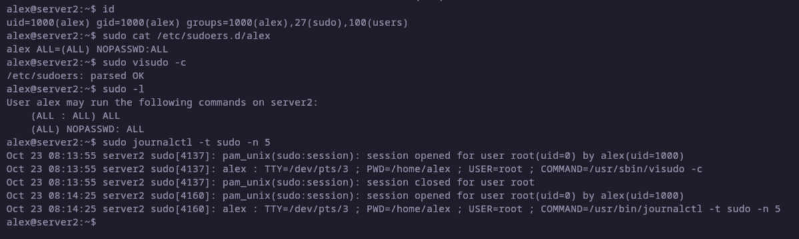
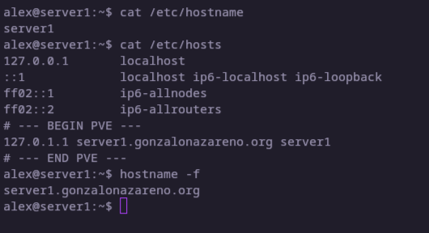
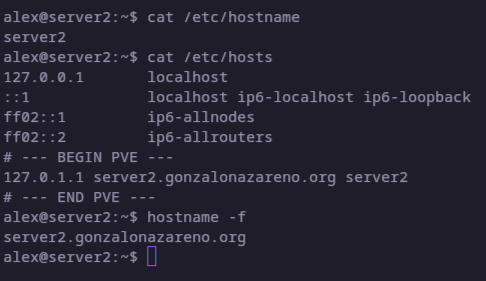
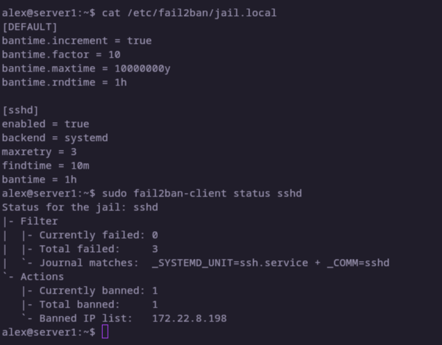
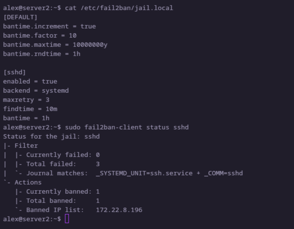
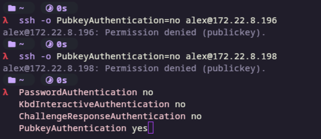

# FCT-Tarea-1

Añade a esta incidencia un documento (o un comentario) con lo siguiente, para cada uno de los dos servidores:

1. Captura de pantalla de la conexión a la VPN (tailscale status o tailscale ip) y del ping a los servidores.



2. Salida del comando id de tu usuario, contenido del fichero que has creado en /etc/sudoers.d/, salida de sudo visudo -c y de sudo -l, y alguna línea del registro donde se vean comandos ejecutados con sudo.





3. Captura del acceso por SSH con tu usuario usando la clave pública (por ejemplo con ssh -v donde se vea el método de autenticación usado).

```bash
λ  ssh -v alex@172.22.8.196
debug1: OpenSSH_10.6p1, OpenSSL 3.6.5 29 Sep 2026
debug1: Reading configuration data /home/aleeex/.ssh/config
debug1: Reading configuration data /etc/ssh/ssh_config
debug1: Reading configuration data /etc/ssh/ssh_config.d/20-systemd-ssh-proxy.conf
debug1: Reading configuration data /etc/ssh/ssh_config.d/30-libvirt-ssh-proxy.conf
debug1: no pubkey loaded from /home/aleeex/.ssh/id_rsa
debug1: identity file /home/aleeex/.ssh/id_rsa type -1
debug1: no identity pubkey loaded from /home/aleeex/.ssh/id_rsa
debug1: no pubkey loaded from /home/aleeex/.ssh/id_ecdsa
debug1: identity file /home/aleeex/.ssh/id_ecdsa type -1
debug1: no identity pubkey loaded from /home/aleeex/.ssh/id_ecdsa
debug1: no pubkey loaded from /home/aleeex/.ssh/id_ecdsa_sk
debug1: identity file /home/aleeex/.ssh/id_ecdsa_sk type -1
debug1: no identity pubkey loaded from /home/aleeex/.ssh/id_ecdsa_sk
debug1: loaded pubkey from /home/aleeex/.ssh/id_ed25519: ED25519 SHA256:t5+1axmSO8fO4Xrfs3hbXeVm1JLSdGXGrGoFKMPgmdc
debug1: identity file /home/aleeex/.ssh/id_ed25519 type 2
debug1: no identity pubkey loaded from /home/aleeex/.ssh/id_ed25519
debug1: no pubkey loaded from /home/aleeex/.ssh/id_ed25519_sk
debug1: identity file /home/aleeex/.ssh/id_ed25519_sk type -1
debug1: no identity pubkey loaded from /home/aleeex/.ssh/id_ed25519_sk
debug1: no pubkey loaded from /home/aleeex/.ssh/id_mldsa44_ed25519
debug1: identity file /home/aleeex/.ssh/id_mldsa44_ed25519 type -1
debug1: no identity pubkey loaded from /home/aleeex/.ssh/id_mldsa44_ed25519
debug1: Connecting to 172.22.8.196 [172.22.8.196] port 22.
debug1: Connection established.
debug1: Local version string SSH-2.0-OpenSSH_10.6
debug1: Remote protocol version 2.0, remote software version OpenSSH_10.0p2 Debian-7+deb13u4
debug1: compat_banner: match: OpenSSH_10.0p2 Debian-7+deb13u4 pat OpenSSH* compat 0x04000000
debug1: Authenticating to 172.22.8.196:22 as 'alex'
debug1: load_hostkeys: fopen /home/aleeex/.ssh/known_hosts2: No such file or directory
debug1: load_hostkeys: fopen /etc/ssh/ssh_known_hosts: No such file or directory
debug1: load_hostkeys: fopen /etc/ssh/ssh_known_hosts2: No such file or directory
debug1: SSH2_MSG_KEXINIT sent
debug1: SSH2_MSG_KEXINIT received
debug1: kex: algorithm: mlkem768x25519-sha256
debug1: kex: host key algorithm: ssh-ed25519
debug1: kex: server->client cipher: chacha20-poly1305@openssh.com MAC: <implicit> compression: none
debug1: kex: client->server cipher: chacha20-poly1305@openssh.com MAC: <implicit> compression: none
debug1: expecting SSH2_MSG_KEX_ECDH_REPLY
debug1: SSH2_MSG_KEX_ECDH_REPLY received
debug1: Server host key: ssh-ed25519 SHA256:acd8kxL4zX+V4hwh1ALd4VVI3IpMIya5rBBfJiHa4PU
debug1: load_hostkeys: fopen /home/aleeex/.ssh/known_hosts2: No such file or directory
debug1: load_hostkeys: fopen /etc/ssh/ssh_known_hosts: No such file or directory
debug1: load_hostkeys: fopen /etc/ssh/ssh_known_hosts2: No such file or directory
debug1: Host '172.22.8.196' is known and matches the ED25519 host key.
debug1: Found key in /home/aleeex/.ssh/known_hosts:4
debug1: ssh_packet_send2_wrapped: resetting send seqnr 3
debug1: rekey out after 134217728 blocks
debug1: SSH2_MSG_NEWKEYS sent
debug1: Sending SSH2_MSG_EXT_INFO
debug1: expecting SSH2_MSG_NEWKEYS
debug1: ssh_packet_read_poll2: resetting read seqnr 3
debug1: SSH2_MSG_NEWKEYS received
debug1: rekey in after 134217728 blocks
debug1: SSH2_MSG_EXT_INFO received
debug1: kex_ext_info_client_parse: server-sig-algs=<ssh-ed25519,ecdsa-sha2-nistp256,ecdsa-sha2-nistp384,ecdsa-sha2-nistp521,sk-ssh-ed25519@openssh.com,sk-ecdsa-sha2-nistp256@openssh.com,rsa-sha2-512,rsa-sha2-256>
debug1: kex_ext_info_check_ver: publickey-hostbound@openssh.com=<0>
debug1: kex_ext_info_check_ver: ping@openssh.com=<0>
debug1: SSH2_MSG_SERVICE_ACCEPT received
debug1: SSH2_MSG_EXT_INFO received
debug1: kex_ext_info_client_parse: server-sig-algs=<ssh-ed25519,ecdsa-sha2-nistp256,ecdsa-sha2-nistp384,ecdsa-sha2-nistp521,sk-ssh-ed25519@openssh.com,sk-ecdsa-sha2-nistp256@openssh.com,rsa-sha2-512,rsa-sha2-256>
debug1: Authentications that can continue: publickey,password
debug1: Next authentication method: publickey
debug1: Will attempt key: /home/aleeex/.ssh/id_rsa 
debug1: Will attempt key: /home/aleeex/.ssh/id_ecdsa 
debug1: Will attempt key: /home/aleeex/.ssh/id_ecdsa_sk 
debug1: Will attempt key: /home/aleeex/.ssh/id_ed25519 ED25519 SHA256:t5+1axmSO8fO4Xrfs3hbXeVm1JLSdGXGrGoFKMPgmdc
debug1: Will attempt key: /home/aleeex/.ssh/id_ed25519_sk 
debug1: Will attempt key: /home/aleeex/.ssh/id_mldsa44_ed25519 
debug1: Trying private key: /home/aleeex/.ssh/id_rsa
debug1: Trying private key: /home/aleeex/.ssh/id_ecdsa
debug1: Trying private key: /home/aleeex/.ssh/id_ecdsa_sk
debug1: Offering public key: /home/aleeex/.ssh/id_ed25519 ED25519 SHA256:t5+1axmSO8fO4Xrfs3hbXeVm1JLSdGXGrGoFKMPgmdc
debug1: Server accepts key: /home/aleeex/.ssh/id_ed25519 ED25519 SHA256:t5+1axmSO8fO4Xrfs3hbXeVm1JLSdGXGrGoFKMPgmdc
Authenticated to 172.22.8.196 ([172.22.8.196]:22) using "publickey".
debug1: channel 0: new session [client-session] (inactive timeout: 0.000000)
debug1: Requesting no-more-sessions@openssh.com
debug1: Entering interactive session.
debug1: pledge: filesystem
debug1: client_input_global_request: rtype hostkeys-00@openssh.com want_reply 0
debug1: client_input_hostkeys: searching /home/aleeex/.ssh/known_hosts for 172.22.8.196 / (none)
debug1: client_input_hostkeys: searching /home/aleeex/.ssh/known_hosts2 for 172.22.8.196 / (none)
debug1: client_input_hostkeys: hostkeys file /home/aleeex/.ssh/known_hosts2 does not exist
debug1: client_input_hostkeys: no new or deprecated keys from server
debug1: Remote: /home/alex/.ssh/authorized_keys:1: key options: agent-forwarding port-forwarding pty user-rc x11-forwarding
debug1: Remote: /home/alex/.ssh/authorized_keys:1: key options: agent-forwarding port-forwarding pty user-rc x11-forwarding
debug1: pledge: fork
Linux server1 7.0.14-15-pve #1 SMP PREEMPT_DYNAMIC PMX 7.0.14-15 (2026-08-26T14:21Z) x86_64

The programs included with the Debian GNU/Linux system are free software;
the exact distribution terms for each program are described in the
individual files in /usr/share/doc/*/copyright.

Debian GNU/Linux comes with ABSOLUTELY NO WARRANTY, to the extent
permitted by applicable law.
Last login: Fri Oct 23 08:17:32 2026 from 100.64.0.84
alex@server1:~$ 
```

```bash
λ  ssh -v alex@172.22.8.198
debug1: OpenSSH_10.6p1, OpenSSL 3.6.5 29 Sep 2026
debug1: Reading configuration data /home/aleeex/.ssh/config
debug1: Reading configuration data /etc/ssh/ssh_config
debug1: Reading configuration data /etc/ssh/ssh_config.d/20-systemd-ssh-proxy.conf
debug1: Reading configuration data /etc/ssh/ssh_config.d/30-libvirt-ssh-proxy.conf
debug1: no pubkey loaded from /home/aleeex/.ssh/id_rsa
debug1: identity file /home/aleeex/.ssh/id_rsa type -1
debug1: no identity pubkey loaded from /home/aleeex/.ssh/id_rsa
debug1: no pubkey loaded from /home/aleeex/.ssh/id_ecdsa
debug1: identity file /home/aleeex/.ssh/id_ecdsa type -1
debug1: no identity pubkey loaded from /home/aleeex/.ssh/id_ecdsa
debug1: no pubkey loaded from /home/aleeex/.ssh/id_ecdsa_sk
debug1: identity file /home/aleeex/.ssh/id_ecdsa_sk type -1
debug1: no identity pubkey loaded from /home/aleeex/.ssh/id_ecdsa_sk
debug1: loaded pubkey from /home/aleeex/.ssh/id_ed25519: ED25519 SHA256:t5+1axmSO8fO4Xrfs3hbXeVm1JLSdGXGrGoFKMPgmdc
debug1: identity file /home/aleeex/.ssh/id_ed25519 type 2
debug1: no identity pubkey loaded from /home/aleeex/.ssh/id_ed25519
debug1: no pubkey loaded from /home/aleeex/.ssh/id_ed25519_sk
debug1: identity file /home/aleeex/.ssh/id_ed25519_sk type -1
debug1: no identity pubkey loaded from /home/aleeex/.ssh/id_ed25519_sk
debug1: no pubkey loaded from /home/aleeex/.ssh/id_mldsa44_ed25519
debug1: identity file /home/aleeex/.ssh/id_mldsa44_ed25519 type -1
debug1: no identity pubkey loaded from /home/aleeex/.ssh/id_mldsa44_ed25519
debug1: Connecting to 172.22.8.198 [172.22.8.198] port 22.
debug1: Connection established.
debug1: Local version string SSH-2.0-OpenSSH_10.6
debug1: Remote protocol version 2.0, remote software version OpenSSH_10.2p1 Ubuntu-2ubuntu3.2
debug1: compat_banner: match: OpenSSH_10.2p1 Ubuntu-2ubuntu3.2 pat OpenSSH* compat 0x04000000
debug1: Authenticating to 172.22.8.198:22 as 'alex'
debug1: load_hostkeys: fopen /home/aleeex/.ssh/known_hosts2: No such file or directory
debug1: load_hostkeys: fopen /etc/ssh/ssh_known_hosts: No such file or directory
debug1: load_hostkeys: fopen /etc/ssh/ssh_known_hosts2: No such file or directory
debug1: SSH2_MSG_KEXINIT sent
debug1: SSH2_MSG_KEXINIT received
debug1: kex: algorithm: mlkem768x25519-sha256
debug1: kex: host key algorithm: ssh-ed25519
debug1: kex: server->client cipher: chacha20-poly1305@openssh.com MAC: <implicit> compression: none
debug1: kex: client->server cipher: chacha20-poly1305@openssh.com MAC: <implicit> compression: none
debug1: expecting SSH2_MSG_KEX_ECDH_REPLY
debug1: SSH2_MSG_KEX_ECDH_REPLY received
debug1: Server host key: ssh-ed25519 SHA256:ac5/ypHxN9ePRo6LoTIxJnpEvN8v9eIWi2fL0WuUwgw
debug1: load_hostkeys: fopen /home/aleeex/.ssh/known_hosts2: No such file or directory
debug1: load_hostkeys: fopen /etc/ssh/ssh_known_hosts: No such file or directory
debug1: load_hostkeys: fopen /etc/ssh/ssh_known_hosts2: No such file or directory
debug1: Host '172.22.8.198' is known and matches the ED25519 host key.
debug1: Found key in /home/aleeex/.ssh/known_hosts:7
debug1: ssh_packet_send2_wrapped: resetting send seqnr 3
debug1: rekey out after 134217728 blocks
debug1: SSH2_MSG_NEWKEYS sent
debug1: Sending SSH2_MSG_EXT_INFO
debug1: expecting SSH2_MSG_NEWKEYS
debug1: ssh_packet_read_poll2: resetting read seqnr 3
debug1: SSH2_MSG_NEWKEYS received
debug1: rekey in after 134217728 blocks
debug1: SSH2_MSG_EXT_INFO received
debug1: kex_ext_info_client_parse: server-sig-algs=<ssh-ed25519,ecdsa-sha2-nistp256,ecdsa-sha2-nistp384,ecdsa-sha2-nistp521,sk-ssh-ed25519@openssh.com,sk-ecdsa-sha2-nistp256@openssh.com,rsa-sha2-512,rsa-sha2-256>
debug1: kex_ext_info_check_ver: publickey-hostbound@openssh.com=<0>
debug1: kex_ext_info_check_ver: ping@openssh.com=<0>
debug1: SSH2_MSG_SERVICE_ACCEPT received
debug1: SSH2_MSG_EXT_INFO received
debug1: kex_ext_info_client_parse: server-sig-algs=<ssh-ed25519,ecdsa-sha2-nistp256,ecdsa-sha2-nistp384,ecdsa-sha2-nistp521,sk-ssh-ed25519@openssh.com,sk-ecdsa-sha2-nistp256@openssh.com,rsa-sha2-512,rsa-sha2-256>
debug1: Authentications that can continue: publickey,password
debug1: Next authentication method: publickey
debug1: Will attempt key: /home/aleeex/.ssh/id_rsa 
debug1: Will attempt key: /home/aleeex/.ssh/id_ecdsa 
debug1: Will attempt key: /home/aleeex/.ssh/id_ecdsa_sk 
debug1: Will attempt key: /home/aleeex/.ssh/id_ed25519 ED25519 SHA256:t5+1axmSO8fO4Xrfs3hbXeVm1JLSdGXGrGoFKMPgmdc
debug1: Will attempt key: /home/aleeex/.ssh/id_ed25519_sk 
debug1: Will attempt key: /home/aleeex/.ssh/id_mldsa44_ed25519 
debug1: Trying private key: /home/aleeex/.ssh/id_rsa
debug1: Trying private key: /home/aleeex/.ssh/id_ecdsa
debug1: Trying private key: /home/aleeex/.ssh/id_ecdsa_sk
debug1: Offering public key: /home/aleeex/.ssh/id_ed25519 ED25519 SHA256:t5+1axmSO8fO4Xrfs3hbXeVm1JLSdGXGrGoFKMPgmdc
debug1: Server accepts key: /home/aleeex/.ssh/id_ed25519 ED25519 SHA256:t5+1axmSO8fO4Xrfs3hbXeVm1JLSdGXGrGoFKMPgmdc
Authenticated to 172.22.8.198 ([172.22.8.198]:22) using "publickey".
debug1: channel 0: new session [client-session] (inactive timeout: 0.000000)
debug1: Requesting no-more-sessions@openssh.com
debug1: Entering interactive session.
debug1: pledge: filesystem
debug1: client_input_global_request: rtype hostkeys-00@openssh.com want_reply 0
debug1: client_input_hostkeys: searching /home/aleeex/.ssh/known_hosts for 172.22.8.198 / (none)
debug1: client_input_hostkeys: searching /home/aleeex/.ssh/known_hosts2 for 172.22.8.198 / (none)
debug1: client_input_hostkeys: hostkeys file /home/aleeex/.ssh/known_hosts2 does not exist
debug1: client_input_hostkeys: no new or deprecated keys from server
debug1: Remote: /home/alex/.ssh/authorized_keys:1: key options: agent-forwarding port-forwarding pty user-rc x11-forwarding
debug1: Remote: /home/alex/.ssh/authorized_keys:1: key options: agent-forwarding port-forwarding pty user-rc x11-forwarding
debug1: pledge: fork
Welcome to Ubuntu 26.04 LTS (GNU/Linux 7.0.14-15-pve x86_64)

 * Documentation:  https://docs.ubuntu.com
 * Management:     https://landscape.canonical.com
 * Support:        https://ubuntu.com/pro
Last login: Fri Oct 23 07:55:55 2026 from 100.64.0.84
alex@server2:~$ 
```


4. Contenido de /etc/hostname y /etc/hosts, y salida de hostname -f.





5. Fichero de configuración de fail2ban que has creado y salida de sudo fail2ban-client status sshd mostrando una IP baneada durante la prueba.





6. Fichero de configuración de SSH que has creado y captura de un intento de acceso con contraseña siendo rechazado (puedes forzarlo con ssh -o PubkeyAuthentication=no).



7. Respuesta a las preguntas planteadas:
    - ¿Qué ventajas tiene usar sudo frente a trabajar como root?
    Una mayor seguridad ya que sudo esta en un nivel de privilegios inferior a root, ademas que sudo se puede auditar ya que cada comando queda guardado en un log propio, a esto tambien le podemos incluir que minimiza los riesgos que puedan suceder por errores del propio ususario

    - ¿Qué significa la línea del grupo sudo en /etc/sudoers? ¿Qué ventaja tiene usar /etc/sudoers.d/? ¿Qué riesgo supone NOPASSWD?
    la linea del grupo sudo es para usuarios que pertenecen al grupo sudo. El usar el .d fomenta que no este todo en un fichero emorme de lines que acabe siendo super engorroso, ademan si falla por algunn error esto no afectara al fichero principal. Por ultimop el pel;igro de que no pida contraseña en ningun momento es que cualquiera que acceda a mi usuario normal podra usar el sudo sin ningun tipo de problema ya que no tiene una contraseña que lo proteja al haberla deshabilitado anteriormente.

    - ¿Por qué es más segura la autenticación por clave pública que por contraseña?
    Esto se debe a que las contraseñas tienen una mayor facilidad de ser hackeadas usando un ataque fuerza bruta, este problema se resuelve si usamos un par de claves ya que estaremos practicamente seguros de que esta sera segura.

    - ¿Qué significan los parámetros maxretry, findtime y bantime de fail2ban y qué valores has elegido?
    El maxretry es el numero de intentos que te va a dejar antes e banearte la ip, si esta en tres al fallar tres seguidos te banea la ip, yo lo tengo puesto en 3 quye es lo que te permite el copmando ssh antes de cerrrarse y que lo tengas que volver a ejecutar de nuevo.
    El findtime es el imntervalo de tiempo que debe de pasar hasta que el intervalo de fallos vuelva a 0, por ejemplo yo lo tengo en diez minitos, si fallas dos veces, y tes esperas diez minutos puedes volver a fallar otras dos veces y nopasara nada.
    El bantime es para indicar el tiempo que estara baneada la direccion ip, en mi casio he puesto 1 hora.

